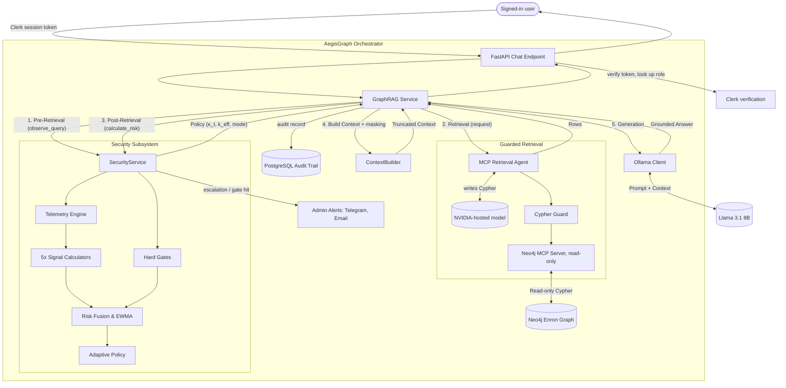

# AegisGraph — Master Technical Architecture

*Describes the system as of November 2026.*

## 1. Project Overview

**AegisGraph** is a research prototype implementing a behavioral security layer for Graph-RAG (Retrieval-Augmented Generation) systems.

Unlike traditional static Role-Based Access Control (RBAC), AegisGraph dynamically modulates information exposure based on the real-time behavioral risk of the user's querying patterns. It detects suspicious exploration, entity-focused probing, and deep graph traversal, smoothly degrading system utility (record limits, masking, blocking) to contain potential data exfiltration while preserving utility for benign users.

Users ask questions about a company email archive (the Enron corpus) in plain English. Every answer is built from records retrieved from the knowledge graph, never from the language model's own knowledge, and every question is scored for risk before any data is retrieved.

## 2. System Architecture

AegisGraph is structured as a pipeline with a secure orchestration layer acting as a mediator between the user, the graph database, and the LLM.

## 3. Technology Stack

- **Backend**: Python 3.10+, FastAPI, Pydantic — served on `http://127.0.0.1:8001`
- **Frontend**: React, Vite, TypeScript, Tailwind CSS, Recharts — served on `http://localhost:5173`
- **Sign-in**: Clerk (the frontend signs users in; the backend verifies every token)
- **Graph Database**: Neo4j
- **Relational Database**: PostgreSQL — audit trail
- **Retrieval Agent LLM**: an NVIDIA-hosted model (`AGENT_MODEL`), reached over the internet
- **Answer Model**: Llama 3.1 8B (`llama3.1:8b`) on Ollama, local, set by `OLLAMA_MODEL`
- **Embedding Model**: `sentence-transformers` (`all-MiniLM-L6-v2`)

## 4. Component Details

### 4.1. The Graph Database
A knowledge graph built from the CMU Enron Corpus and enriched by `backend/scripts/enrich_graph.py` (titles and seniority for core employees, communication links, email sensitivity scores, themes and folders) and `backend/scripts/generate_embeddings.py` (vectors for search by meaning).
- **Nodes**: `Person`, `Email`, `Topic`, `Theme`, `Folder`
- **Edges**: `SENT`, `SENT_TO`, `CC_TO`, `BCC_TO`, `DISCUSSES`, `REPLY_TO`, `COMMUNICATES_WITH`, `ABOUT`, `IN_FOLDER`

### 4.2. Guarded Retrieval Agent
The sole interface to the data (`app/retrieval/mcp_agent.py`). An LLM writes its own read-only Cypher for each question, inside four independent layers:
1. A guard in code: one statement only, no write or admin keywords, and `LIMIT` forced down to the user's policy limit.
2. The Neo4j MCP server runs read-only and refuses anything the planner marks as a write.
3. It connects as a Neo4j user with the built-in `reader` role, so the database itself refuses writes.
4. A 15-second read timeout.

- **Search by meaning**: a second tool runs vector search over email text.
- **Pronoun follow-ups** ("What emails has he sent?") are rewritten with the name of the last person found.
- **If the agent is unavailable** (no internet, rate limit), the user is told to try again; the question is still scored and audited.

### 4.3. Graph-RAG Answer Generation
Connects retrieval to the LLM via deterministic context construction, with grounding instructions and length truncation (at most 20 records and 8,000 characters of evidence).
- **No evidence, no LLM**: if a data question retrieves nothing, the answer "I couldn't find that in the knowledge graph" is returned directly. The LLM is never asked to answer from empty evidence, which is where it used to invent facts.

### 4.4. Behavioral Telemetry & Risk Model
Calculates five behavioral signals per query:
1. **Semantic Focus** (`S_sem`): Mean cosine similarity across a sliding window (default: last 5) of recent query embeddings. High values mean the user is repeatedly circling the same topic — focused, potentially risky probing.
2. **Temporal Frequency** (`S_temp`): Exponential decay of the gap in seconds since the previous query — rapid-fire queries push this toward 1.0.
3. **Entity Focus** (`S_ent`): Shannon entropy of entity concentration.
4. **Graph Footprint** (`S_graph`): A fixed depth estimate plus result volume (not a live Neo4j shortest-path calculation).
5. **Sensitivity Exposure** (`S_sens`): What the user actually received: a fading total of each retrieved email's sensitivity score, weighted by the seniority of the people on it.

Signals are linearly fused with static, equal weights and smoothed via Exponential Weighted Moving Average (EWMA) to produce a risk score `Γ̄_t`.

- **Hard gates** set a minimum risk for a single obviously hostile query, whatever the history: prompt-injection or privilege-escalation wording → 0.65 (HIGH), bulk requests for sensitive personal data → 0.35 (MEDIUM).
- **Risk is remembered per user**, not per session, so starting a new session does not reset it. It halves for every 5 minutes of inactivity (`SECURITY_RISK_HALF_LIFE_SECONDS = 300`).

### 4.5. Adaptive Policy & Response Control
Translates the continuous EWMA risk into concrete system restrictions using a sigmoid attenuation factor (`κ_t`), centered at `θ_mid = 0.55`.
- Discrete risk bands and response modes: **LOW** below 0.35 → normal access; **MEDIUM** 0.35–0.65 → names, email addresses, phone numbers and SSNs are masked; **HIGH** at/above 0.65 → the query is blocked.
- Masking is done in code, both before the evidence reaches the LLM and again on the answer and the graph data, so it does not depend on the LLM obeying an instruction.
- Limits the number of rows the agent can fetch and pass on (`effective_context_limit`).
- `effective_graph_depth` is calculated and shown in the risk panel, but is informational: the agent's queries are limited by row count, not traversal depth.

### 4.6. Identity and Roles
Every endpoint requires a Clerk sign-in. The backend verifies the token's signature and assigns the role itself from `SECURITY_USER_ROLES` in `.env` (`clerk_user_id:Role`); a client can never choose its own role. Unlisted users are `Standard`.

| Role | Max records | Max graph depth | Can open admin dashboard |
|---|---|---|---|
| Standard | 10 | 2 | No |
| Analyst | 20 (system cap) | 3 | No |
| Auditor | 20 (system cap) | 5 | Yes |

Privilege never reduces scrutiny: every role is masked at MEDIUM risk and blocked at HIGH.

### 4.7. User and Admin Interfaces
- **`/app` — Query Playground** (every signed-in user): the chat, the graph visualization of each answer, and a status strip showing the user's role, their current risk score and the policy their next question will face. Risk and policy are read from the server, so they are correct after a page reload.
- **`/admin` — Admin Dashboard** (Auditors only; enforced in the browser and again by the API):
  - **Overview**: a live risk feed across all users (refreshes every 5 seconds), who asked the latest question, and the alert channel status with a "Send test alert" button.
  - **Audit Log**: every session and every question — who asked, when, the risk score, the response mode and the outcome.

### 4.8. Audit Trail
Every question is recorded in PostgreSQL (`audit_sessions`, `audit_queries`) with the user's Clerk ID and email, role, risk score, the five signal values, the agent's Cypher, the policy applied, the outcome (permitted, masked, attenuated, blocked) and the number of records returned. New columns are added automatically at startup.

The user's email appears only if the Clerk session token is customized to include it (Clerk dashboard → Sessions → Customize session token: `{"email": "{{user.primary_email_address}}"}`); otherwise the Clerk user ID is shown.

### 4.9. Admin Alerts
The security service notifies the admin over **Telegram** and/or **email (Gmail SMTP)** when:
- a user's mode escalates (normal → masked, or masked → blocked) — once per escalation, not on every question;
- any hard gate is hit (prompt injection, bulk personal-data requests) — every time;
- one answer pulls 5 or more sensitive emails.

Each alert names the user, their role, the risk score, the question and the time. Channels stay off until their settings (`TELEGRAM_*`, `SMTP_*`, `ALERT_EMAIL_TO`) are filled in. Alerts are sent in the background so they never delay an answer, and the Telegram bot token is redacted from error logs.

## 5. Security Timing Constraints

A critical architectural invariant is the **Execution Timing**:
1. Policy `t` is calculated based on EWMA `t-1`.
2. Retrieval `t` is restricted by Policy `t`.
3. Telemetry `t` observes Retrieval `t`.
4. EWMA `t` is updated using Telemetry `t`.

This prevents circular dependencies where the current query's results affect its own restrictions.

## 6. Known Limitations and Future Work

1. **Depth Estimate**: `S_graph` uses a fixed depth estimate rather than measuring real Neo4j hop counts, and depth is not enforced on agent queries.
2. **Static Weights**: Risk signals are equally weighted (20% each). Future implementations should use learned or domain-tuned weights.
3. **Internet Dependency**: Data questions need the hosted agent model; there is no offline retrieval path.
4. **No Cross-User Aggregation**: Risk is remembered per user across sessions, but coordinated behavior across several users is not detected.
5. **Split Identities**: The Enron data often stores one person under several addresses (e.g. `chris.calger@enron.com` and `calger@enron.com`); these are not merged, so a lookup may return one address's emails only.
6. **Evidence Cap**: Long result lists are truncated to 8,000 characters before reaching the LLM, so a summary may cover fewer emails than were retrieved.
7. **Local 8B Model**: Answer phrasing can still hedge or be imprecise on long email lists; grounding and the no-evidence rule prevent invented facts, but not all imprecision.
