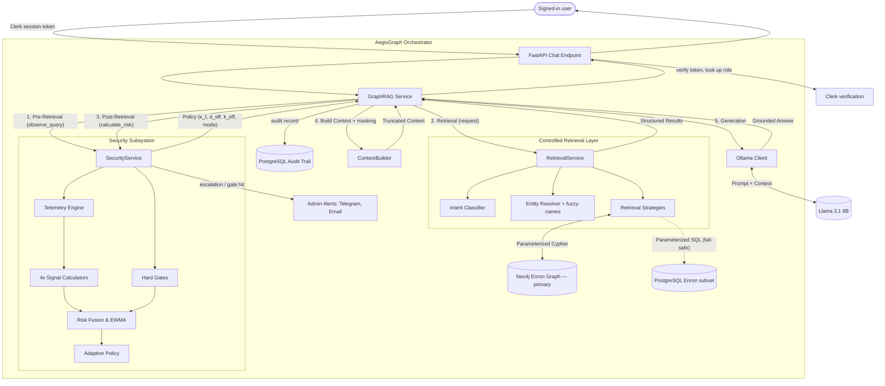

# AegisGraph — Master Technical Architecture

*Describes the system as of October 2026. The dated, phase-by-phase development notes it grew
out of are kept in [`archive/`](./archive/README.md).*

## 1. Project Overview

**AegisGraph** is a research prototype implementing a behavioral security layer for Graph-RAG (Retrieval-Augmented Generation) systems.

Unlike traditional static Role-Based Access Control (RBAC), AegisGraph dynamically modulates information exposure based on the real-time behavioral risk of the user's querying patterns. It detects suspicious exploration, entity-focused probing, and deep graph traversal, smoothly degrading system utility (context limits and graph depth) to contain potential data exfiltration while preserving utility for benign users.

Users ask questions about a company email archive (the Enron corpus) in plain English. Every answer is built from records retrieved from the knowledge graph, never from the language model's own knowledge, and every question is scored for risk before any data is retrieved.

## 2. System Architecture

AegisGraph is structured as a pipeline with a secure orchestration layer acting as a mediator between the user, the graph database, and the LLM.

## 3. Technology Stack

- **Backend**: Python 3.10+, FastAPI, Pydantic — served on `http://127.0.0.1:8001`
- **Frontend**: React, Vite, TypeScript, Tailwind CSS, Recharts — served on `http://localhost:5173`
- **Sign-in**: Clerk (the frontend signs users in; the backend verifies every token)
- **Graph Database (primary)**: Neo4j (async Python driver)
- **Relational Database**: PostgreSQL — audit trail, plus an optional copy of part of the dataset used as a retrieval fail-safe
- **LLM Engine**: Ollama (local execution, no cloud calls)
- **Primary Model**: Llama 3.1 8B (`llama3.1:8b`), set by `OLLAMA_MODEL`. It replaced Qwen 2.5 Coder 7B, which invented people when no evidence was found.
- **Embedding Model**: `sentence-transformers` (`all-MiniLM-L6-v2`)
- **NLP**: spaCy (`en_core_web_sm`) for topic extraction when the dataset is ingested

## 4. Component Details

### 4.1. The Graph Database
A knowledge graph built from the CMU Enron Corpus: 87,469 unique people, 251,449 unique emails, and 218,836 unique topics (ingestion counts are written to `neo4j_import/stats.json` by the import step, outside this repository).
- **Nodes**: `Person` (email, name), `Email` (email_id, sent_at, subject, message_id, source_path, body), `Topic` (name)
- **Edges**: `SENT` (Person→Email), `SENT_TO` (Email→Person), `CC_TO` (Email→Person), `DISCUSSES` (Email→Topic), `REPLY_TO` (Email→Email)
- Most `Person` nodes have no stored name; the email address carries it (e.g. `vince.kaminski@enron.com`).
- History: [Phase1_Dataset_and_Graph_Foundation.md](./archive/Phase1_Dataset_and_Graph_Foundation.md)

### 4.2. Controlled Retrieval Layer
The sole interface to the data. Prevents arbitrary query execution, enforces intent classification, and provides structural safeguards (parameterization, hard limits).
- **Intent classification** is rule-based first; when no rule matches, the local LLM extracts the intent and the person being asked about.
- **Entity resolution** tries an exact match, then **typo-tolerant (fuzzy) matching**, and only then the LLM. Fuzzy matching lets "Christopher Calgar" find `christopher.calger@enron.com`. It uses a Neo4j full-text index (`person_name_fuzzy`, created at startup) or, in fail-safe mode, PostgreSQL `pg_trgm`. When two candidates score within 5% of each other the user is asked to be more specific.
- **Pronoun follow-ups** ("What emails has he sent?") are rewritten with the name of the last person found.
- History: [Phase2_Controlled_Retrieval.md](./archive/Phase2_Controlled_Retrieval.md)

### 4.3. Graph-RAG Answer Generation
Connects retrieval to the LLM via deterministic context construction, with grounding instructions and length truncation (at most 20 records and 8,000 characters of evidence).
- **No evidence, no LLM**: if a data question retrieves nothing, the answer "I couldn't find that in the knowledge graph" is returned directly. The LLM is never asked to answer from empty evidence, which is where it used to invent facts.
- History: [Phase3_Baseline_Graph_RAG.md](./archive/Phase3_Baseline_Graph_RAG.md)

### 4.4. Behavioral Telemetry & Risk Model
Calculates four behavioral signals per query:
1. **Semantic Focus** (`S_sem`): Mean cosine similarity across a sliding window (default: last 5) of recent query embeddings. High values mean the user is repeatedly circling the same topic — focused, potentially risky probing.
2. **Temporal Frequency** (`S_temp`): Exponential decay of the gap in seconds since the previous query — rapid-fire queries push this toward 1.0.
3. **Entity Focus** (`S_ent`): Shannon entropy of entity concentration.
4. **Graph Footprint** (`S_graph`): Heuristic graph depth and result volume, keyed on query intent (not a live Neo4j shortest-path calculation).

Signals are linearly fused with static, equal weights and smoothed via Exponential Weighted Moving Average (EWMA) to produce a risk score `Γ̄_t`.

- **Hard gates** set a minimum risk for a single obviously hostile query, whatever the history: prompt-injection or privilege-escalation wording → 0.65 (HIGH), bulk requests for sensitive personal data → 0.35 (MEDIUM).
- **Risk is remembered per user**, not per session, so starting a new session does not reset it. It halves for every 5 minutes of inactivity (`SECURITY_RISK_HALF_LIFE_SECONDS = 300`).
- History: [Phase4A_Behavioral_Telemetry.md](./archive/Phase4A_Behavioral_Telemetry.md), [Phase4B_Risk_Model.md](./archive/Phase4B_Risk_Model.md)

### 4.5. Adaptive Policy & Response Control
Translates the continuous EWMA risk into concrete system restrictions using a sigmoid attenuation factor (`κ_t`), centered at `θ_mid = 0.55`.
- Discrete risk bands and response modes: **LOW** below 0.35 → normal access; **MEDIUM** 0.35–0.65 → names, email addresses, phone numbers and SSNs are masked; **HIGH** at/above 0.65 → the query is blocked.
- Masking is done in code, both before the evidence reaches the LLM and again on the answer and the graph data, so it does not depend on the LLM obeying an instruction.
- Limits the number of records passed to the context builder (`effective_context_limit`).
- Blocks intents that require a graph traversal deeper than permitted (`effective_graph_depth`).
- History: [Phase4C1_Adaptive_Policy.md](./archive/Phase4C1_Adaptive_Policy.md), [Phase4C2_Policy_Retrieval_Integration.md](./archive/Phase4C2_Policy_Retrieval_Integration.md), [Phase4C3_Response_Control.md](./archive/Phase4C3_Response_Control.md)

### 4.6. Identity and Roles
Every endpoint except `/health*` requires a Clerk sign-in. The backend verifies the token's signature and assigns the role itself from `SECURITY_USER_ROLES` in `.env` (`clerk_user_id:Role`); a client can never choose its own role. Unlisted users are `Standard`.

| Role | Max records | Max graph depth | Can open admin dashboard |
|---|---|---|---|
| Standard | 10 | 2 | No |
| Analyst | 20 (system cap) | 3 | No |
| Auditor | 20 (system cap) | 5 | Yes |

Privilege never reduces scrutiny: every role is masked at MEDIUM risk and blocked at HIGH.

### 4.7. User and Admin Interfaces
- **`/app` — Query Playground** (every signed-in user): the chat, the graph visualization of each answer, and a status strip showing the user's role, their current risk score and the policy their next question will face. Risk and policy are read from the server, so they are correct after a page reload.
- **`/admin` — Admin Dashboard** (Auditors only; enforced in the browser and again by the API):
  - **Overview**: a live risk feed across all users (refreshes every 5 seconds), who asked the latest question, and the alert channel status with a "Send test alert" button.
  - **Audit Log**: every session and every question — who asked, when, the risk score, the response mode and the outcome.

### 4.8. Audit Trail
Every question is recorded in PostgreSQL (`audit_sessions`, `audit_queries`) with the user's Clerk ID and email, role, intent, risk score, the four signal values, the policy applied, the outcome (permitted, masked, attenuated, blocked) and the number of records returned. New columns are added automatically at startup.

The user's email appears only if the Clerk session token is customized to include it (Clerk dashboard → Sessions → Customize session token: `{"email": "{{user.primary_email_address}}"}`); otherwise the Clerk user ID is shown.

### 4.9. Admin Alerts
The security service notifies the admin over **Telegram** and/or **email (Gmail SMTP)** when:
- a user's mode escalates (normal → masked, or masked → blocked) — once per escalation, not on every question;
- any hard gate is hit (prompt injection, bulk personal-data requests) — every time.

Each alert names the user, their role, the risk score, the question and the time. Channels stay off until their settings (`TELEGRAM_*`, `SMTP_*`, `ALERT_EMAIL_TO`) are filled in. Alerts are sent in the background so they never delay an answer, and the Telegram bot token is redacted from error logs.

### 4.10. PostgreSQL Retrieval Fail-safe
Neo4j is the primary store. Setting `USE_POSTGRES_RETRIEVAL=true` switches only the retrieval layer to a PostgreSQL copy of part of the dataset; security, auditing, masking and answer generation are unchanged, and Neo4j keeps running.
- **Coverage**: 9 of the corpus's ~150 mailboxes (`sanders-r`, `haedicke-m`, `derrick-j`, `kitchen-l`, `lavorato-j`, `skilling-j`, `lay-k`, `kaminski-v`, `kean-s`) — 88,464 emails, 25,982 people, 736,948 recipient links and 53,538 topics. People outside these mailboxes' correspondence are not found in this mode.
- **Loaded by** `backend/scripts/ingest_enron_postgres.py`, which is safe to re-run.
- **Not available in this mode**: semantic (vector) search over email text.
- In a side-by-side test of five questions (lookups, a pronoun follow-up and misspelled names), both backends gave answers of equivalent quality; the difference between them is coverage, not accuracy.

## 5. Security Timing Constraints

A critical architectural invariant is the **Execution Timing**:
1. Policy `t` is calculated based on EWMA `t-1`.
2. Retrieval `t` is restricted by Policy `t`.
3. Telemetry `t` observes Retrieval `t`.
4. EWMA `t` is updated using Telemetry `t`.

This prevents circular dependencies where the current query's results affect its own restrictions.

## 6. End-to-End Evaluation

As recorded in the Phase 4D evaluation (August 2026), the prototype was evaluated against 8 behavioral scenarios. It demonstrated:
- **0.0% utility degradation** for benign exploration.
- **Graceful limit throttling** during progressive risk escalation.
- **Active blocking** and **41.8% exposure reduction** against sustained multi-vector graph probing.
- See [Phase4D_End_to_End_Evaluation.md](./archive/Phase4D_End_to_End_Evaluation.md). The charts are in [`figures/`](./figures/).

## 7. Known Limitations and Future Work

1. **Intent-to-Depth Abstraction**: `S_graph` relies on a heuristic mapping of intent to depth rather than parsing physical Neo4j hop counts.
2. **Static Weights**: Risk signals are equally weighted (25% each). Future implementations should utilize learned or domain-tuned weights.
3. **Rule-Based Classification**: Intent classification uses regex patterns first and falls back to the local LLM.
4. **No Cross-User Aggregation**: Risk is remembered per user across sessions, but coordinated behavior across several users is not detected.
5. **Split Identities**: The Enron data often stores one person under several addresses (e.g. `chris.calger@enron.com` and `calger@enron.com`); these are not merged, so a lookup may return one address's emails only.
6. **Evidence Cap**: Long result lists are truncated to 8,000 characters before reaching the LLM, so a summary may cover fewer emails than were retrieved.
7. **Local 8B Model**: Answer phrasing can still hedge or be imprecise on long email lists; grounding and the no-evidence rule prevent invented facts, but not all imprecision.
8. **Fail-safe Coverage**: The PostgreSQL copy holds 9 mailboxes only and has no semantic search (see 4.10).
